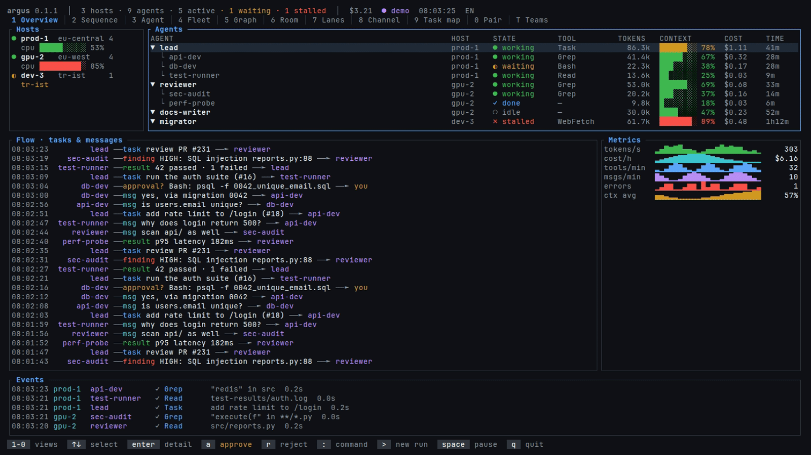
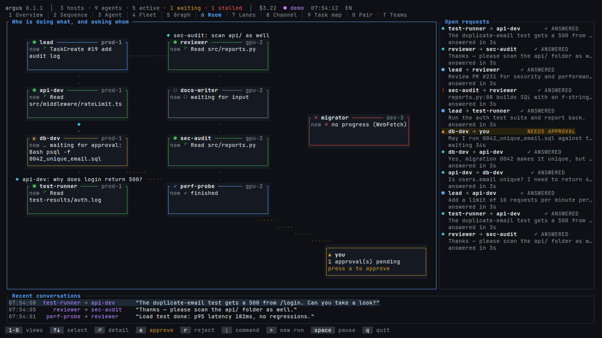
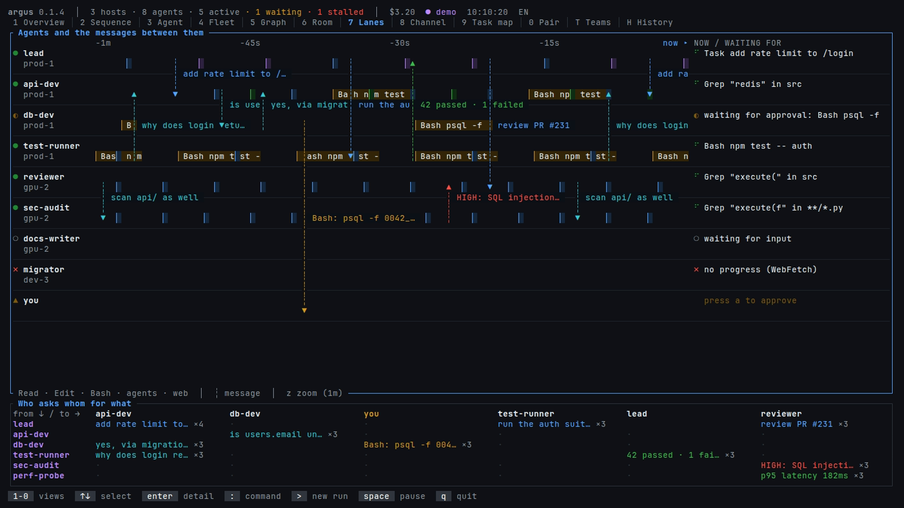
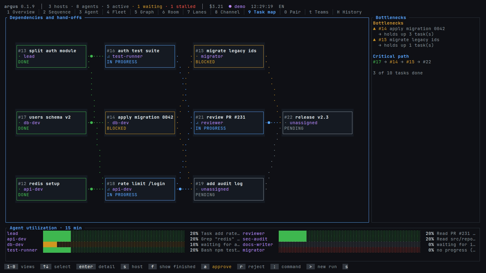

# Argus

**Watch and steer your Claude Code agents live, from the terminal, on any machine.**

Argus is a terminal UI that shows what every Claude Code agent is doing *right now*:
which tool it is running, how much context and money it is burning, and — above all —
**how agents hand off tasks and talk to each other**. Connect to remote machines over SSH
and see all of your agents, on every host, in one place.

> **Status:** early development — all ten views work with the live collector and the demo.
> Star the repo to follow along.



## Why Argus?

Existing tools pick one side: cozy pixel-art offices that look great but tell you little,
or `htop`-style tables that tell you numbers but not the story. Argus keeps a classic
terminal aesthetic and gives you both — full metrics *and* a live picture of the
conversation between your agents.

## Features (planned for v1.0)

- **Teams** — the coordinator on top, one card per busy team with its roles (which are at work now) and each agent's task and activity, finished teams on one line, cross-team requests; `t` opens it (`Enter` filters every view to the chosen team). Setups with configured teams start on this view
- **Ten views, one keystroke apart** — switch instantly with `1`–`0` or `tab`; the selected agent follows you
- **Live agent graph** — messages travel between agents in real time; edge width shows traffic
- **"Who asks whom for what"** — every open request, who is waiting on whom, and for how long
- **Full metrics** — tokens, cache hits, context window, cost, throughput, tool calls, files touched
- **Remote machines over SSH** — `:connect prod-1` and the collector installs itself; no ports to open
- **Drive your agents** — start new Claude Code runs, message running agents, approve permission requests
- **Multilingual UI** — English and Turkish today; translations welcome
- **Cross-platform** — a single binary for macOS, Linux and Windows

## Views

| Overview | Live graph |
|---|---|
|  |  |
| **Room** | **Lanes** |
|  |  |
| **Task map** | **Pair** |
|  |  |


| # | View | What it shows |
|---|---|---|
| 1 | Overview | Hosts, agent tree, metrics, event log |
| 2 | Sequence | Agents as lanes, messages as arrows, task board |
| 3 | Agent | Context breakdown, cost, tool calls, live transcript |
| 4 | Fleet | Every connected host, collector health, alerts |
| 5 | Graph | Live network: coordinator on top, a cluster per team (lead above its agents), messages in flight; `g` groups by host |
| 6 | Room | What each agent is doing now and what it is asking for |
| 7 | Lanes | Scrolling per-agent timelines with cross-agent messages |
| 8 | Channel | IRC-style live chat between agents |
| 9 | Task map | Orchestrator runs with their stages (analysis → merge), who has each, rework loops and bottlenecks; task dependencies when there are no runs |
| 0 | Pair | Two agents side by side, their conversation in between |
| t | Teams | Coordinator, a card per busy team, cross-team requests |
| H | History | Finished agents with duration, cost and outcome |

## Install

**macOS / Linux (Homebrew)**

```sh
brew tap serkankoyun/argus https://github.com/serkankoyun/argus
brew install serkankoyun/argus/argus
```

**Windows (Scoop)** — run it in Windows Terminal. (Not on winget yet: `winget install argus`
finds unrelated programs with the same name.)

```powershell
scoop bucket add argus https://github.com/serkankoyun/argus
scoop install argus/argus
```

Update later with `brew update && brew upgrade argus` or `scoop update; scoop update argus`.

Or download an archive for macOS, Linux or Windows from the
[latest release](https://github.com/serkankoyun/argus/releases), or build from source:

```sh
cargo install --git https://github.com/serkankoyun/argus
```

**Full guide: [docs/INSTALL.md](docs/INSTALL.md)** — per-platform steps, first run,
approvals, remote machines, troubleshooting and uninstalling.

## Usage

```sh
argus                      # watch agents on this machine
argus --demo               # explore the UI with sample data
argus --lang tr            # force a UI language (default: system locale)
argus --claude-dir <DIR>   # read another Claude config dir (default: ~/.claude)
```

| Key | Action |
|---|---|
| `1`–`0` / `F1`–`F10` / click a tab | Jump to a view |
| `tab` / `shift+tab` | Next / previous view |
| `↑` `↓` / `j` `k` | Select agent (the selection follows you across views) |
| `Enter` / `esc` | Agent detail / back to Overview |
| `z` | Zoom the Lanes timeline |
| `t` / `T` | Open the Teams view (`Enter` filters all views to that team) / cycle the team filter |
| `s` | Filter all views to one host (cycles); on Fleet, `↑↓` + `Enter` picks a host |
| `f` / `H` | Show finished agents in the views / open History (finished agents are hidden by default) |
| `↑↓` `Enter` (Teams) | Pick a team and open it: every view shows that team; `esc` from any view returns to all teams |
| `g` | Group Graph and Room by team instead of host |
| `a` / `r` | Approve / reject the pending permission request |
| `:` | Command bar: `connect user@host`, `msg <text>`, `run <dir> <prompt>`, `view <name>`, `lang tr` |
| `>` | Start a new headless Claude Code run in the selected agent's project |
| `space` | Pause / resume live updates |
| `q` | Quit |

## Remote machines

```sh
argus --host me@prod-1 --host me@gpu-2   # or press : and type connect me@prod-1
```

Argus uses your own `ssh` (keys, config, jump hosts all work). If the remote has no
`argus`, it is installed into `~/.cache/argus/` automatically — copied over SSH when the
platforms match, otherwise downloaded by the server from the releases page (so Windows →
Linux works too).
Nothing listens on a port; the collector stops when you disconnect.

## Approving from Argus

```sh
argus hook --install    # adds lifecycle-event and PermissionRequest hooks to ~/.claude/settings.json
```

Claude Code then asks Argus first: press `a` or `r`. If nobody answers within
`--wait` seconds (default 120) the normal permission prompt appears. The event hooks tell
Argus exactly when a tool starts and ends and when a session waits for you; other tools can
report the same way ([docs/EVENTS.md](docs/EVENTS.md)). Teams encoded in agent names can be
described in `~/.claude/argus/teams.json`; `argus init` suggests the rules from the names
([docs/INSTALL.md](docs/INSTALL.md)).

## Roadmap

- **v0.1** ✓ — local collector, Overview, agent tree, metrics, EN + TR, view switching
- **v0.2** ✓ — Graph, Room, Lanes, Agent, Sequence, Fleet, Channel, Task map, Pair views
- **v0.3** ✓ — remote machines over SSH, Fleet view, Windows support
- **v0.4** ✓ — command bar, launching agents, remote approvals, teams
- **v1.0** — replay, per-team budgets and metrics, winget, documentation site

See [`docs/PROJECT_BRIEF.md`](docs/PROJECT_BRIEF.md) for the full design.

## Contributing

Contributions are welcome — especially translations. See [`CONTRIBUTING.md`](CONTRIBUTING.md).

## License

[MIT](LICENSE)

---

*Argus is an independent project and is not affiliated with or endorsed by Anthropic.
"Claude" and "Claude Code" are trademarks of Anthropic.*
